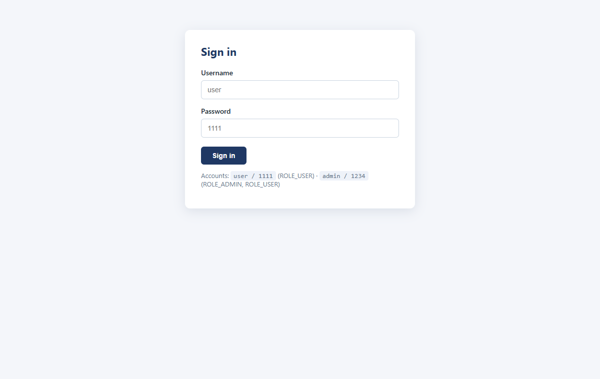
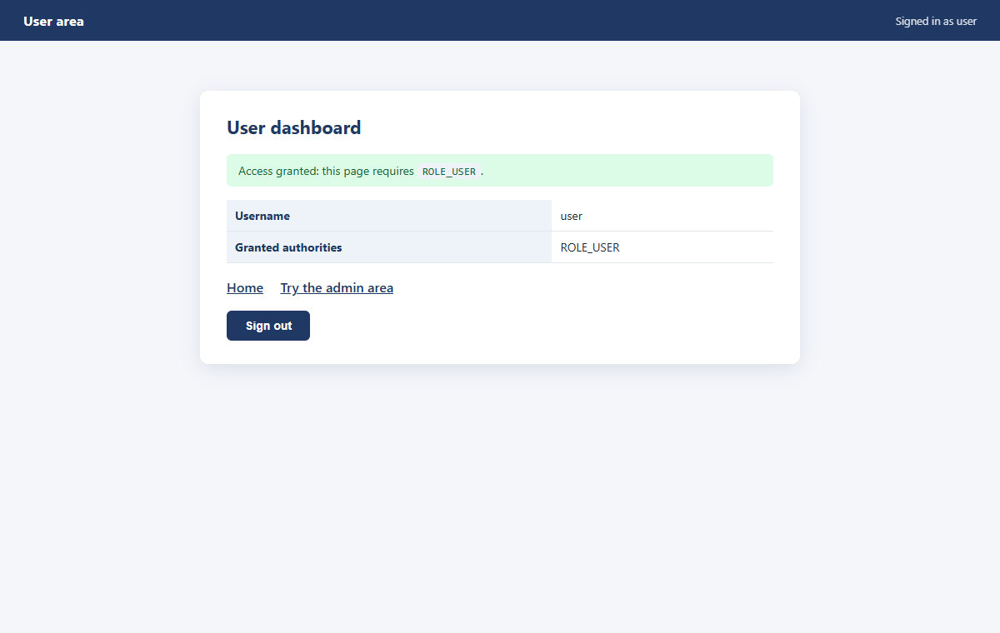
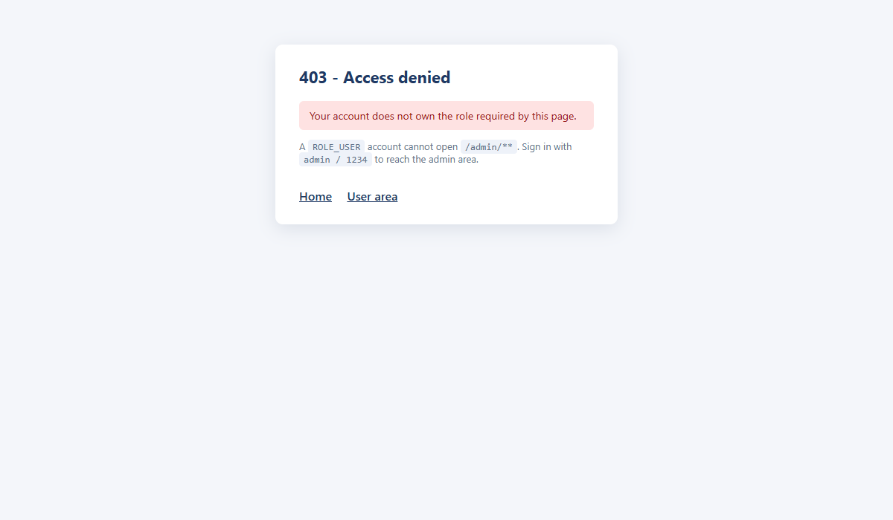

# J2E-Spring-TP9 — Authentification en mémoire

TP 9 du cours *Développement JakartaEE : Spring* — Spring Security avec utilisateurs en mémoire, mots de passe BCrypt et accès par rôle.



## Stack

`Java 17` · `Spring Boot 3.3` · `Spring Security` · `Thymeleaf` · `BCrypt`

## Lancer

```bash
mvn spring-boot:run   # http://localhost:8081
mvn test
```

Comptes créés au démarrage : `user / 1111` (ROLE_USER) · `admin / 1234` (ROLE_ADMIN + ROLE_USER)

## Règles d'accès

| URL | Rôle requis |
|---|---|
| `/`, `/login` | public |
| `/user/**` | ROLE_USER |
| `/admin/**` | ROLE_ADMIN |

## Architecture

```
config/  SecurityConfig   SecurityFilterChain + InMemoryUserDetailsManager + BCryptPasswordEncoder
web/     HomeController   routes /, /login, /user/dashboard, /admin/dashboard
templates/                index, login, user_dashboard, admin_dashboard, access_denied
```





Un compte ROLE_USER obtient un **403** sur `/admin/dashboard`, redirigé vers la page d'accès refusé.

## Tests

**9/9** — `SecurityConfigTest` : page publique, redirection des anonymes, 403 sur `/admin`, connexion valide/invalide, hash BCrypt vérifié, double rôle de l'admin.

Auteur : [zAK4-7](https://github.com/zAK4-7)
